# BÀI THỰC HÀNH 4: BẢO MẬT WEB APP VÀ API

Dự án triển khai bộ công cụ kiểm thử bảo mật ứng dụng Web (**WebVulnScanner**) và bộ công cụ bảo mật xác thực Token (**JWTSecure**) trong khuôn khổ môn học Thực hành Lập trình An toàn Thông tin.

---

## 📑 Mục Lục

1. [Giới Thiệu Đề Tài](#-giới-thiệu-đề-tài)
2. [Cấu Trúc Thư Mục Dự Án](#-cấu-trúc-thư-mục-dự-án)
3. [Phần 1: Công Cụ Quét Lỗ Hổng Web (WebVulnScanner)](#-phần-1-công-cụ-quét-lỗ-hổng-web-webvulnscanner)
   - [Tính năng chính](#tính-năng-chính)
   - [Cài đặt và chạy kiểm thử Unittest](#cài-đặt-và-chạy-kiểm-thử-unittest)
   - [Chạy chương trình chính (CLI)](#chạy-chương-trình-chính-cli)
   - [Khởi chạy giao diện Web UI](#khởi-chạy-giao-diện-web-ui)
4. [Phần 2: Bộ Công Cụ Bảo Mật JWT & OAuth (JWTSecure)](#-phần-2-bộ-công-cụ-bảo-mật-jwt--oauth-jwtsecure)
   - [Tính năng chính](#tính-năng-chính-1)
   - [Cài đặt và chạy kiểm thử Pytest](#cài-đặt-và-chạy-kiểm-thử-pytest)
   - [Khởi chạy API Gateway & Sinh Token](#khởi-chạy-api-gateway--sinh-token)
   - [Xác thực Bearer Token qua cURL](#xác-thực-bearer-token-qua-curl)
5. [Hình Ảnh Minh Họa Thực Hành và Kết Quả](#-hình-ảnh-minh-họa-thực-hành-và-kết-quả)
6. [Tác Giả](#-tác-giả)

---

## 🎯 Giới Thiệu Đề Tài

* **WebVulnScanner:** Xây dựng công cụ rà soát và kiểm thử lỗ hổng bảo mật Web tự động dựa trên các chuẩn kiểm thử OWASP Top 10:
  * **XSSScanner:** Phát hiện lỗ hổng Cross-Site Scripting (Reflected XSS) thông qua tập payload chuẩn hóa.
  * **SQLInjectionTester:** Phát hiện biến thể tấn công SQL Injection (Classic, Union-based, Boolean-based).
  * **CSRFDetector:** Phân tích mã nguồn form HTML, phát hiện các form thiếu token bảo vệ Cross-Site Request Forgery.
  * **SSRFTester:** Phát hiện các tham số URL có nguy cơ tấn công Server-Side Request Forgery trỏ tới tài nguyên nội bộ (`127.0.0.1`, `localhost`, IP private `10.x`, `192.168.x`, `172.x`).
  * **ReportGenerator:** Tổng hợp, phân loại mức độ rủi ro (`Critical`, `High`, `Medium`, `Low`) và kết xuất báo cáo.
  * **Web UI (Flask):** Giao diện Web thân thiện cho phép nhập URL mục tiêu, tùy chọn mô-đun kiểm thử và hiển thị báo cáo trực quan.

* **JWTSecure (JWT & OAuth Toolkit):** Phát triển hệ thống xác thực an toàn bằng JSON Web Token và chuẩn ủy quyền OAuth 2.0:
  * **APIGateway:** Cổng API bảo vệ endpoint nghiệp vụ `/protected`, xác thực Bearer token theo thuật toán mã hóa HMAC SHA-256 (`HS256`).
  * **JWTCracker:** Tấn công vét cạn (brute-force) khóa bí mật HMAC yếu qua danh sách từ điển bằng cơ chế đa luồng (`ThreadPoolExecutor`).
  * **JWTValidator:** Kiểm tra toàn diện tính toàn vẹn chữ ký số, tính hợp lệ cấu trúc và thời hạn sử dụng của Token (`exp`).
  * **OAuthClient:** Cài đặt luồng ủy quyền chuẩn Authorization Code Flow của giao thức OAuth 2.0.
  * **TokenManager:** Quản trị vòng đời token an toàn, bao gồm phát hành cặp Access Token (hạn ngắn 15 phút) / Refresh Token (hạn dài 24 giờ) và cơ chế tái cấp phát Access Token hợp lệ.

---

## 🗂️ Cấu Trúc Thư Mục Dự Án

```text
lab 4/
├── images/                             # Thư mục chứa hình ảnh minh chứng thực hành
│   ├── image1.png                      # Cấu trúc thư mục web-vuln-scanner
│   ├── image2.png                      # Cài đặt thư viện phụ thuộc bằng pip
│   ├── image3.png                      # Kết quả kiểm thử tự động unittest (9/9 pass)
│   ├── image4.png                      # Chạy main.py xuất báo cáo console
│   ├── image5.png                      # Giao diện Web Vulnerability Scanner
│   ├── image6.png                      # Báo cáo kết quả quét lỗ hổng Web UI
│   ├── image7.png                      # Commit mã nguồn phần 1 vào Git
│   ├── image8.png                      # Cấu trúc thư mục jwt-security-tools
│   ├── image9.png                      # Kết quả kiểm thử tự động pytest (7/7 pass)
│   ├── image10.png                     # Khởi chạy server API Gateway và sinh token
│   ├── image11.png                     # Xác thực quyền truy cập API qua cURL
│   └── image12.png                     # Commit mã nguồn phần 2 và lịch sử Git log
│
├── web-vuln-scanner/                   # Phần 1: Web Vulnerability Scanner
│   ├── report/                         # Mô-đun tạo báo cáo
│   │   ├── __init__.py
│   │   └── report_generator.py         # Bộ sinh báo cáo lỗ hổng
│   ├── scanners/                       # Các bộ quét bảo mật
│   │   ├── __init__.py
│   │   ├── csrf_detector.py            # Quét lỗ hổng CSRF
│   │   ├── sql_injection_tester.py     # Quét lỗ hổng SQL Injection
│   │   ├── ssrf_tester.py              # Quét lỗ hổng SSRF
│   │   └── xss_scanner.py              # Quét lỗ hổng XSS
│   ├── tests/                          # Bộ kiểm thử tự động (Unittest)
│   │   ├── __init__.py
│   │   ├── test_csrf.py
│   │   ├── test_report.py
│   │   ├── test_sql_injection.py
│   │   ├── test_ssrf.py
│   │   └── test_xss.py
│   ├── ui/                             # Giao diện Web Flask
│   │   ├── templates/
│   │   │   ├── index.html              # Form nhập URL và chọn scanner
│   │   │   └── result.html             # Trang kết quả hiển thị lỗ hổng
│   │   └── app.py                      # Flask Application Server
│   ├── __init__.py
│   ├── main.py                         # Chương trình quét mẫu qua CLI
│   └── requirements.txt                # Thư viện phụ thuộc (Flask, requests)
│
├── jwt-security-tools/                 # Phần 2: JWT & OAuth Security Tools
│   ├── api_gateway/                    # Mô-đun API Gateway
│   │   ├── __init__.py
│   │   └── gateway.py                  # API Gateway xác thực Bearer token
│   ├── jwt_cracker/                    # Mô-đun bẻ khóa JWT
│   │   ├── __init__.py
│   │   └── cracker.py                  # JWTCracker brute force đa luồng
│   ├── jwt_validator/                  # Mô-đun kiểm định JWT
│   │   ├── __init__.py
│   │   └── validator.py                # JWTValidator kiểm tra chữ ký và hạn dùng
│   ├── oauth_client/                   # Mô-đun OAuth 2.0 Client
│   │   ├── __init__.py
│   │   └── client.py                   # OAuthClient Authorization Code flow
│   ├── token_manager/                  # Mô-đun quản lý vòng đời token
│   │   ├── __init__.py
│   │   └── manager.py                  # TokenManager cấp phát và refresh token
│   ├── tests/                          # Bộ kiểm thử tự động (Pytest)
│   │   ├── __init__.py
│   │   ├── test_api_gateway.py
│   │   ├── test_cracker.py
│   │   ├── test_oauth_client.py
│   │   ├── test_token_manager.py
│   │   └── test_validator.py
│   ├── main.py                         # Khởi chạy server và sinh token demo
│   ├── pytest.ini                      # Cấu hình pytest
│   └── requirements.txt                # Thư viện phụ thuộc (PyJWT, requests, flask, pytest)
│
├── .gitignore
└── README.md
```

---

## 🛡️ Phần 1: Công Cụ Quét Lỗ Hổng Web (WebVulnScanner)

### Tính năng chính
* Tự động kiểm thử các loại lỗ hổng Web nguy hiểm nhất: XSS, SQLi, CSRF, SSRF.
* Hỗ trợ quét qua cả hai phương thức: Dòng lệnh console (CLI) và Giao diện Web tương tác (Web UI).
* Tự động đánh giá mức độ nghiêm trọng: `Critical`, `High`, `Medium`, `Low`.

### Cài đặt và chạy kiểm thử Unittest
1. Di chuyển vào thư mục `web-vuln-scanner`:
   ```powershell
   cd web-vuln-scanner
   ```
2. Cài đặt các thư viện cần thiết:
   ```powershell
   pip install -r requirements.txt
   ```
3. Chạy toàn bộ 9 ca kiểm thử tự động bằng unittest:
   ```powershell
   python -m unittest discover tests
   ```
   *(Toàn bộ 9/9 test cases hoàn thành với kết quả OK).*

### Chạy chương trình chính (CLI)
Thực thi quét URL mẫu chứa payload tấn công:
```powershell
python main.py
```

### Khởi chạy giao diện Web UI
Khởi động máy chủ giao diện Flask:
```powershell
python ui/app.py
```
Truy cập trình duyệt tại địa chỉ: `http://127.0.0.1:5000/`
* Nhập URL cần kiểm thử.
* Tích chọn các mô-đun kiểm thử: XSS Scanner, SQL Injection Tester, CSRF Detector, SSRF Tester.
* Nhấn **Bắt đầu kiểm thử** để xem báo cáo lỗ hổng chi tiết.

---

## 🔑 Phần 2: Bộ Công Cụ Bảo Mật JWT & OAuth (JWTSecure)

### Tính năng chính
* Kiểm tra toàn diện tính toàn vẹn, chữ ký số và thời hạn của JSON Web Token.
* Thử nghiệm bẻ khóa secret key yếu dùng thuật toán HMAC SHA-256 (`HS256`).
* Triển khai cổng API Gateway xác thực Bearer Token an toàn.
* Quản lý trọn vẹn vòng đời Token: cấp phát cặp Access Token / Refresh Token và cơ chế làm mới token an toàn.

### Cài đặt và chạy kiểm thử Pytest
1. Di chuyển vào thư mục `jwt-security-tools`:
   ```powershell
   cd jwt-security-tools
   ```
2. Cài đặt các thư viện cần thiết:
   ```powershell
   pip install -r requirements.txt
   ```
3. Chạy 7 ca kiểm thử tự động với Pytest:
   ```powershell
   pytest tests/
   ```
   *(Toàn bộ 7/7 test cases đạt 100% passed).*

### Khởi chạy API Gateway & Sinh Token
Thực thi file `main.py` để sinh Access Token và Refresh Token cho người dùng, đồng thời khởi chạy server API Gateway:
```powershell
python main.py
```
Server lắng nghe tại `http://127.0.0.1:5000/`.

### Xác thực Bearer Token qua cURL
Mở terminal/command prompt và kiểm thử xác thực tới endpoint `/protected`:
1. **Truy cập với Access Token hợp lệ:**
   ```powershell
   curl -H "Authorization: Bearer <access_token>" http://127.0.0.1:5000/protected
   ```
   *Kết quả phản hồi HTTP 200 OK:*
   ```json
   {"message": "Access granted", "user": "phuoc"}
   ```

2. **Truy cập với Token không hợp lệ:**
   ```powershell
   curl -H "Authorization: Bearer invalid_token" http://127.0.0.1:5000/protected
   ```
   *Kết quả phản hồi HTTP 401 Unauthorized:*
   ```json
   {"message": "Access denied"}
   ```

---

## 📸 Hình Ảnh Minh Họa Thực Hành và Kết Quả

Dưới đây là hình ảnh chụp lại chi tiết toàn bộ các bước thực hiện bài thực hành và kết quả đạt được:

### 1. Phần WebVulnScanner (Mục 4.2)

#### Hình 1: Cấu trúc thư mục mã nguồn WebVulnScanner
Hiển thị đầy đủ cây thư mục mã nguồn bao gồm các gói scanners, report, tests và giao diện web UI:

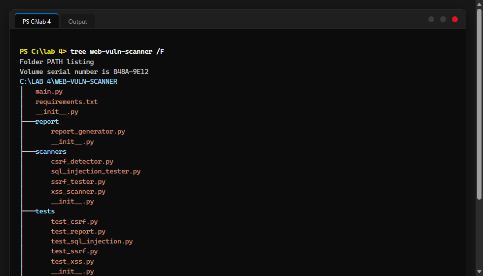

#### Hình 2: Cài đặt các gói thư viện phụ thuộc
Thực hiện cài đặt các thư viện trong `requirements.txt` bằng lệnh pip:

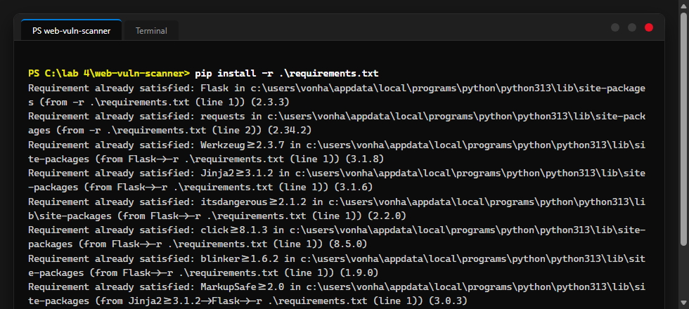

#### Hình 3: Thực thi kiểm thử tự động Unittest
Toàn bộ 9/9 ca kiểm thử tự động cho các bộ scanner và report generator đều đạt kết quả OK:

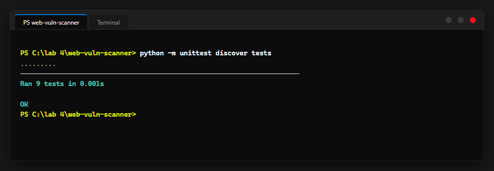

#### Hình 4: Chạy chương trình chính (main.py)
Quét mẫu URL chứa payload và xuất bảng báo cáo lỗ hổng ra console:

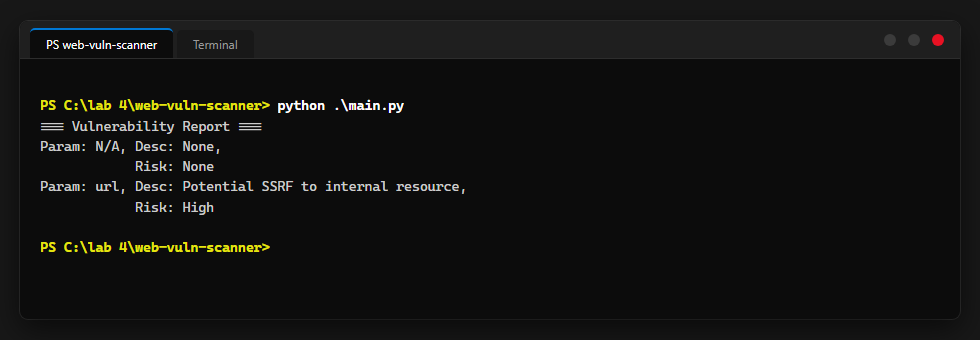

#### Hình 5: Giao diện Web Vulnerability Scanner
Giao diện người dùng Web tại `http://127.0.0.1:5000/` cho phép nhập mục tiêu và lựa chọn công cụ kiểm thử:

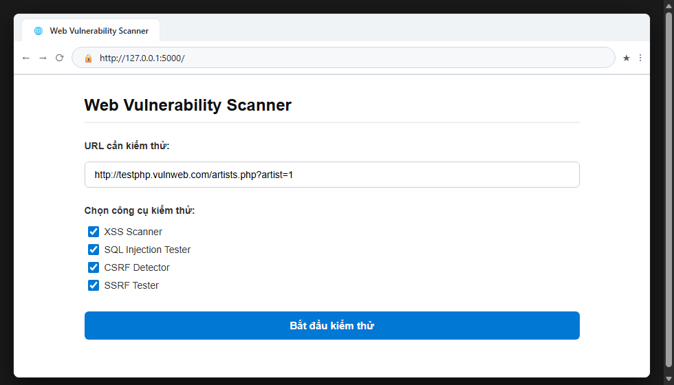

#### Hình 6: Báo cáo kết quả quét lỗ hổng trên Web UI
Kết quả phân tích trực quan phân loại rủi ro theo màu sắc (XSS mức độ HIGH, CSRF mức độ Medium):

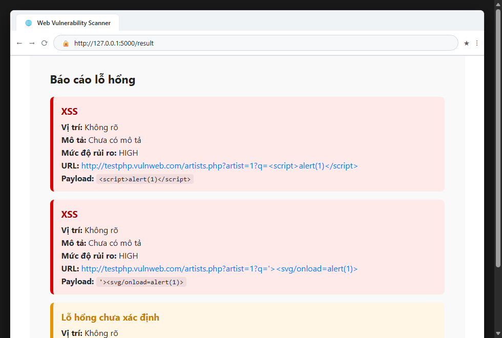

#### Hình 7: Quản lý phiên bản Git cho Phần 1
Thực hiện commit mã nguồn Phần 1 với thông điệp `[add] web vuln scanner`:

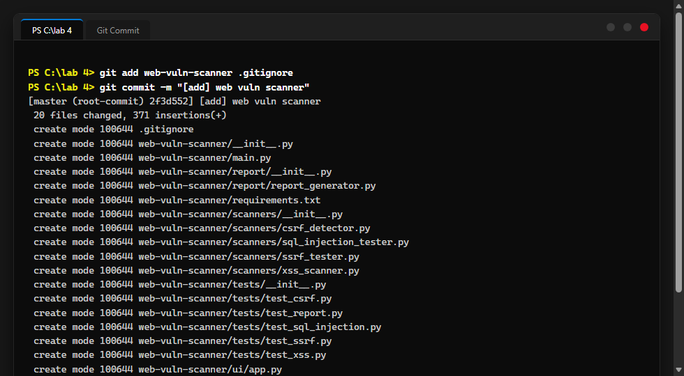

---

### 2. Phần JWTSecure (Mục 4.4)

#### Hình 8: Cấu trúc thư mục mã nguồn JWTSecure
Hiển thị cấu trúc mã nguồn các gói API Gateway, JWT Cracker, Validator, OAuth Client và Token Manager:

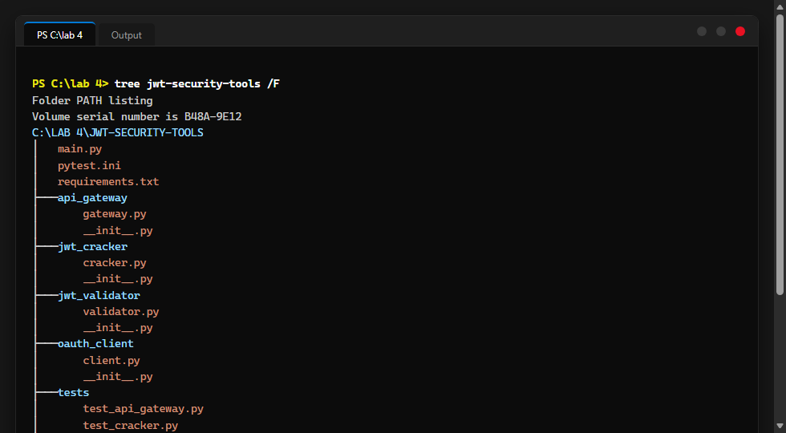

#### Hình 9: Thực thi kiểm thử tự động Pytest
Toàn bộ 7/7 ca kiểm thử tự động bảo mật JWT đều vượt qua thành công (100% passed):

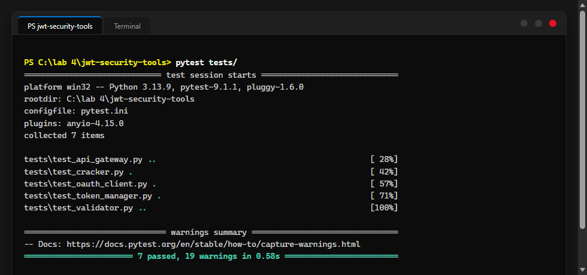

#### Hình 10: Khởi chạy API Gateway và hiển thị Access/Refresh Token
Tập tin `main.py` sinh cặp Access Token và Refresh Token cho người dùng `phuoc` và khởi động server:

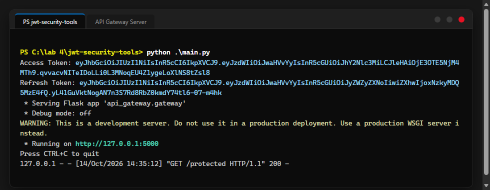

#### Hình 11: Kiểm thử xác thực quyền truy cập qua cURL
Gửi Access Token trong header Authorization xác thực thành công HTTP 200, và chặn truy cập trái phép HTTP 401:

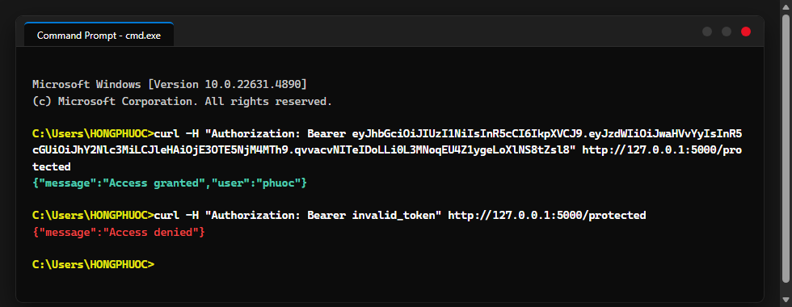

#### Hình 12: Quản lý phiên bản Git cho Phần 2 và lịch sử commit
Thực hiện commit mã nguồn Phần 2 với thông điệp `[add] jwt security tools` và kiểm tra lịch sử commit bằng `git log`:

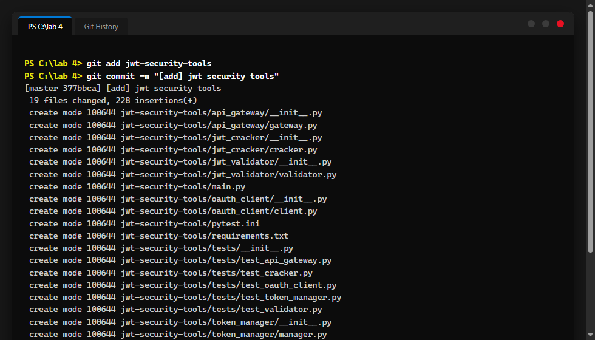

---

## ✍️ Tác Giả

* **Họ và tên:** Võ Nhật Minh
* **Mã số sinh viên (MSSV):** 2387700170
* **Môn học:** Thực hành Lập trình An toàn Thông tin (TH_LTANTT)
