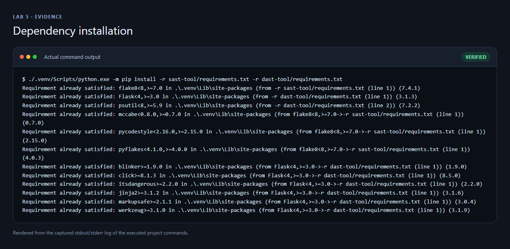
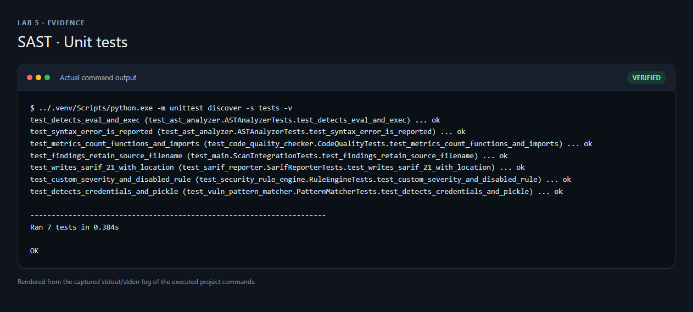
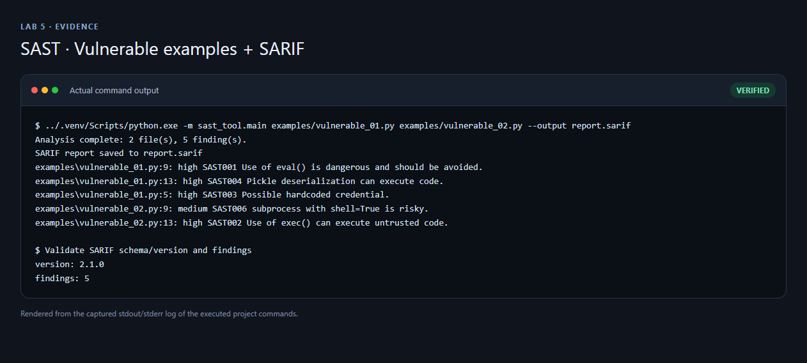
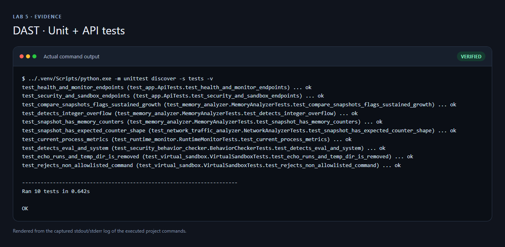
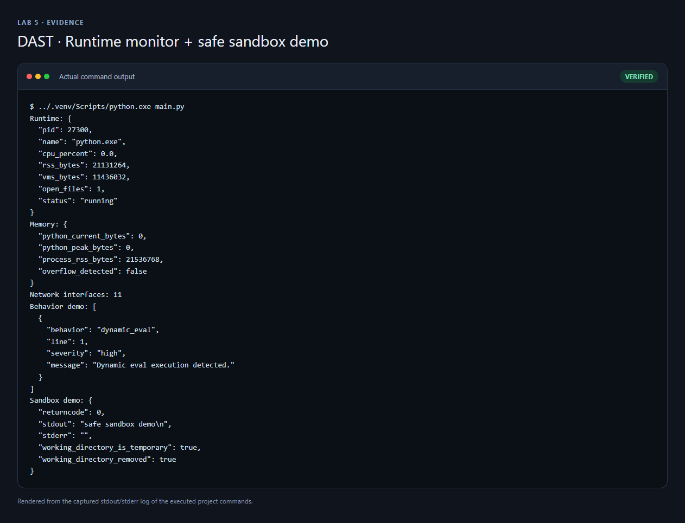
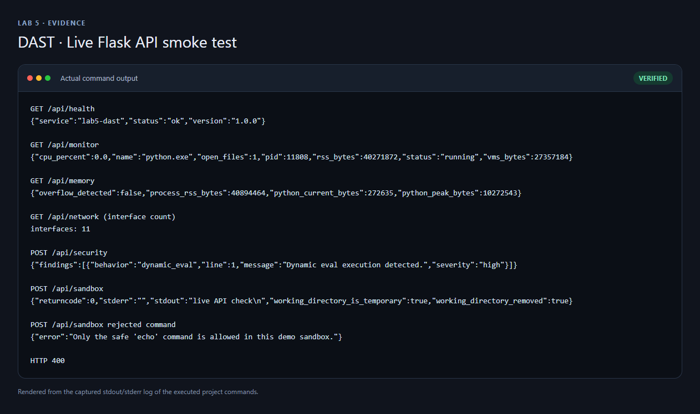

# Bài 5 — Phân tích và kiểm thử bảo mật (SAST & DAST)

Bài thực hành gồm hai công cụ Python độc lập: phân tích mã nguồn tĩnh để phát hiện mẫu rủi ro và phân tích động cơ bản qua giám sát tiến trình, bộ nhớ, bộ đếm mạng và một Flask API. Các ví dụ có lỗ hổng được cố ý tạo để kiểm tra bộ quét; không dùng chúng trong sản phẩm thật.

## Ảnh chụp kết quả

Các ảnh được tạo từ stdout/stderr thực tế của lệnh chạy và kiểm thử, trình bày trong khung terminal để dễ đọc khi đưa lên GitHub.

### Cài đặt dependencies



### SAST: unit test và SARIF





### DAST: unit test và giám sát runtime





### Flask API chạy thật trên localhost



## Thành phần đã triển khai

### `sast-tool/`

- `ASTAnalyzer`: duyệt AST Python, phát hiện `eval`, `exec`, giải tuần tự `pickle`, `subprocess.Popen(shell=True)` và lỗi cú pháp.
- `VulnPatternMatcher`: dò credential hardcode và mẫu `pickle`.
- `SecurityRuleEngine`: nạp luật JSON, cho phép chỉnh severity, mô tả và tắt luật.
- `CodeQualityChecker`: đo số hàm, dependency, hàm dài/độ phức tạp cao và nhận thêm lỗi `flake8` khi cài.
- `SarifReporter`: ghi `report.sarif` theo SARIF 2.1.0.
- Ví dụ dễ tổn thương: `examples/vulnerable_01.py`, `examples/vulnerable_02.py`.

### `dast-tool/`

- `RuntimeMonitor`: số liệu tức thời của một process bằng `psutil`.
- `MemoryAnalyzer`: RSS, số liệu `tracemalloc`, kiểm tra tràn số nguyên và heuristic so sánh hai snapshot để đánh dấu tăng bộ nhớ đáng ngờ.
- `NetworkTrafficAnalyzer`: bộ đếm byte/gói theo interface từ hệ điều hành.
- `SecurityBehaviorChecker`: AST-check mã được gửi vào, không thực thi đoạn mã đó.
- `VirtualSandbox`: chỉ cho chạy `echo`, không dùng shell, timeout ngắn, thư mục tạm tự xóa.
- Flask API: `/api/health`, `/api/monitor`, `/api/memory`, `/api/network`, `/api/security` (POST), `/api/sandbox` (POST).

## Cài đặt và chạy trên Windows

Từ thư mục gốc bài lab:

```powershell
py -3.13 -m venv .venv
.\.venv\Scripts\python.exe -m pip install -r sast-tool/requirements.txt -r dast-tool/requirements.txt
```

### Chạy SAST

```powershell
cd sast-tool
..\.venv\Scripts\python.exe -m unittest discover -s tests -v
..\.venv\Scripts\python.exe -m sast_tool.main examples/vulnerable_01.py examples/vulnerable_02.py --rules rules/default_rules.json --output report.sarif
```

Kết quả xác minh trong lần chạy hiện tại: **7/7 unit tests đạt**; quét hai file ví dụ phát hiện **5 vấn đề**; báo cáo được kiểm tra là SARIF `2.1.0`. Mở `sast-tool/report.sarif` bằng extension SARIF Viewer của VS Code nếu muốn xem findings theo giao diện.

### Chạy DAST

```powershell
cd ..\dast-tool
..\.venv\Scripts\python.exe -m unittest discover -s tests -v
..\.venv\Scripts\python.exe main.py
..\.venv\Scripts\python.exe app.py
```

Flask chỉ bind vào `127.0.0.1:5000`. Trong PowerShell khác, thử API:

```powershell
Invoke-RestMethod http://127.0.0.1:5000/api/health
Invoke-RestMethod -Method Post -Uri http://127.0.0.1:5000/api/security `
  -ContentType 'application/json' -Body '{"source":"eval(user_input)"}'
Invoke-RestMethod -Method Post -Uri http://127.0.0.1:5000/api/sandbox `
  -ContentType 'application/json' -Body '{"command":["echo","hello"]}'
```

Kết quả xác minh trong lần chạy hiện tại: **10/10 unit tests đạt**; các endpoint được gọi qua HTTP thật. API từ chối lệnh sandbox ngoài allowlist với HTTP `400`.

## Cấu trúc thư mục

```text
lab 5/
├── README.md
├── .gitignore
├── .flake8
├── screenshots/
│   ├── setup.png
│   ├── sast-tests.png
│   ├── sast-scan.png
│   ├── dast-tests.png
│   ├── dast-run.png
│   └── dast-api.png
├── sast-tool/
│   ├── examples/
│   ├── rules/default_rules.json
│   ├── sast_tool/
│   └── tests/
└── dast-tool/
    ├── app.py
    ├── tests/
    └── ...
```

## Giới hạn an toàn và phạm vi

- Đây là bài lab giáo dục, không phải SAST/DAST đầy đủ hoặc chứng nhận bảo mật.
- Bộ phân tích chỉ nhận diện một số mẫu; không bảo đảm phát hiện mọi lỗ hổng.
- Bộ đếm network là tổng theo interface, không đọc nội dung gói tin hay gán lưu lượng cho từng process.
- `MemoryAnalyzer.compare()` là heuristic giữa hai snapshot; tăng bộ nhớ không tự nó chứng minh có memory leak.
- `VirtualSandbox` **không phải** VM/container hay ranh giới cách ly hệ điều hành. Nó chỉ cho phép `echo`, chạy không shell trong thư mục tạm và có timeout. Không chạy file lạ hoặc mã độc trong máy thật.
- Các file `vulnerable_*.py` chứa mẫu nguy hiểm có chủ đích; chỉ dùng làm fixture kiểm thử.
