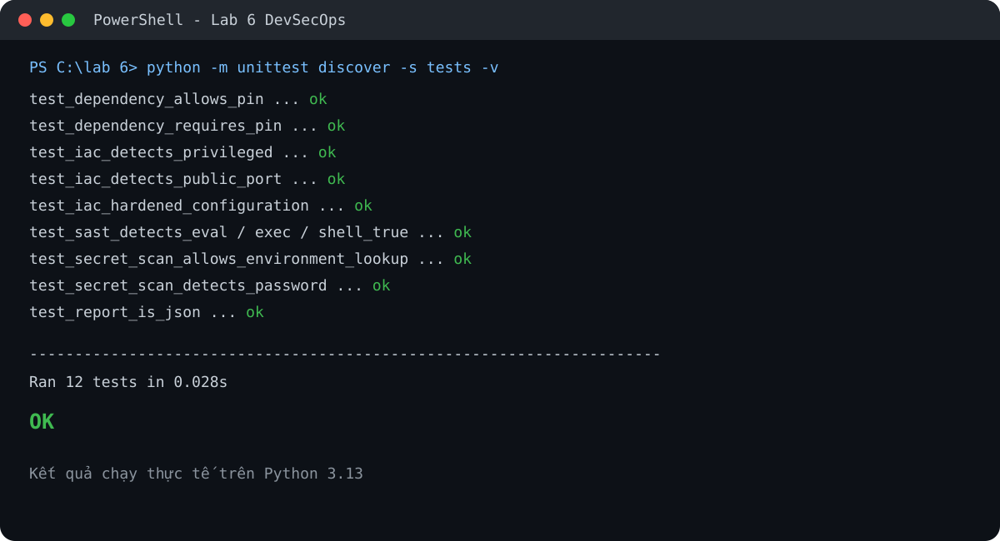
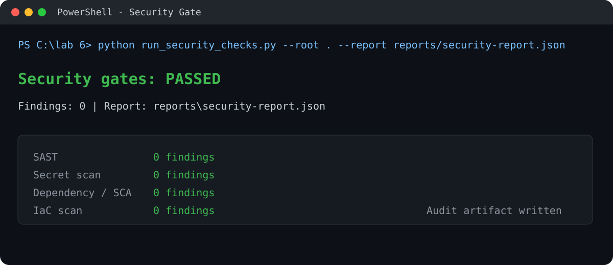
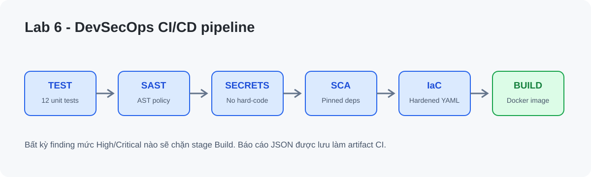

# Bài 6 - Bảo mật với DevSecOps

**Sinh viên:** Võ Nhật Minh - **MSSV:** 2387700170  
**Môn học:** Thực hành Lập trình An toàn Thông tin

## Mục tiêu

Triển khai các cổng bảo mật tự động trong CI/CD theo tinh thần *shift-left*:

- Kiểm thử đơn vị cho logic của bộ quét.
- SAST bằng phân tích AST Python, phát hiện `eval`, `exec` và `shell=True`.
- Secret scanning, phát hiện token/password/API key bị hard-code.
- SCA tối giản, kiểm tra dependency phải được pin phiên bản và chặn package nằm trong deny-list minh hoạ.
- IaC scanning cho Docker Compose, kiểm tra privileged container, mount Docker socket, port public và cấu hình hardening.
- Xuất báo cáo JSON làm artifact để audit.

## Ảnh chụp kết quả

### Unit tests và các security gates





### Luồng pipeline DevSecOps



## Cấu trúc thư mục

```text
lab 6/
├── .github/workflows/devsecops.yml    # Pipeline cho GitHub Actions
├── .gitlab-ci.yml                     # Pipeline tương đương cho GitLab CI
├── devsecops/security_gates.py        # Các security gates dùng stdlib
├── infra/docker-compose.yml            # IaC đã được harden
├── reports/                            # Artifact JSON (bỏ qua bởi Git)
├── screenshots/                        # Ảnh minh chứng kết quả chạy
├── tests/test_security_gates.py        # 12 unit tests
├── Dockerfile                          # Container chạy non-root
├── requirements.txt
└── run_security_checks.py              # Entry point của pipeline
```

## Chạy cục bộ

Yêu cầu Python 3.11+; dự án không phụ thuộc package bên thứ ba.

```powershell
cd "lab 6"
python -m unittest discover -s tests -v
python run_security_checks.py --root . --report reports/security-report.json
```

Pipeline chỉ cho phép tiếp tục khi không còn finding mức `high` hoặc `critical`. Báo cáo JSON là artifact để truy vết sau mỗi lần chạy.

## Thiết kế pipeline

```text
test -> sast -> secrets -> dependency -> iac -> build
```

- `test`: xác minh hành vi các bộ kiểm tra.
- `sast`, `secrets`, `dependency`, `iac`: là các cổng bắt buộc; lỗi high/critical làm pipeline dừng.
- `build`: chỉ chạy sau khi tất cả cổng bảo mật đạt, build Docker image không push registry và không dùng secret.

`Dockerfile` dùng base image slim, chạy bằng user không đặc quyền. `infra/docker-compose.yml` giới hạn bind `127.0.0.1`, bật `read_only`, `no-new-privileges` và loại bỏ capabilities.

## Lưu ý an toàn

Các chuỗi secret/vulnerable code chỉ được tạo tạm trong unit test để xác minh scanner, không tồn tại trong source deploy. Pipeline không tự động triển khai production; bước triển khai thực tế phải được bảo vệ bởi environment approval và secrets manager của nền tảng CI/CD.
